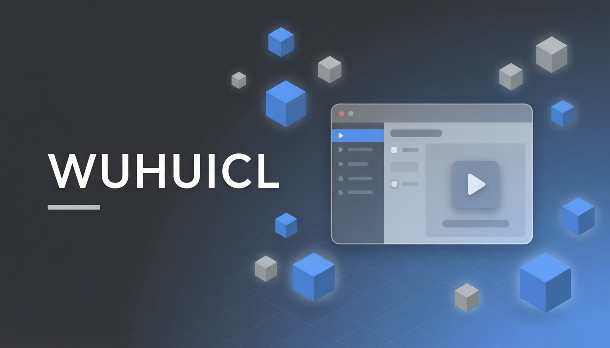
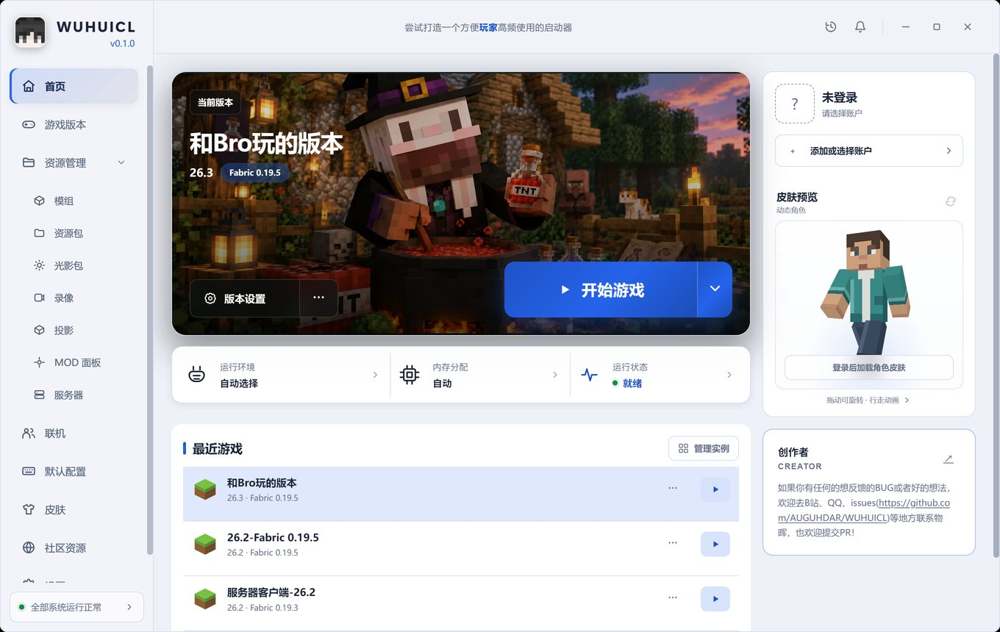
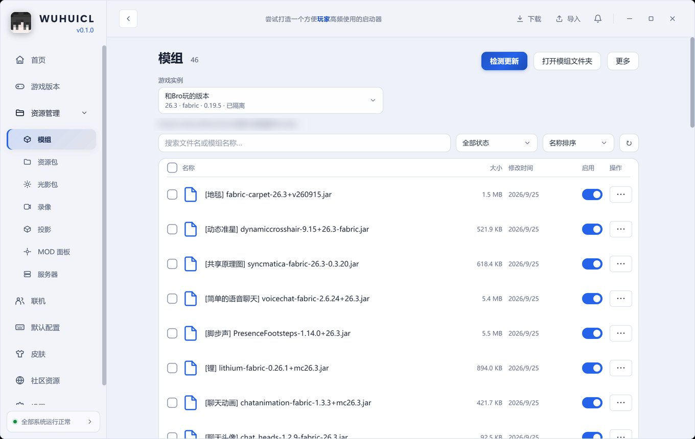
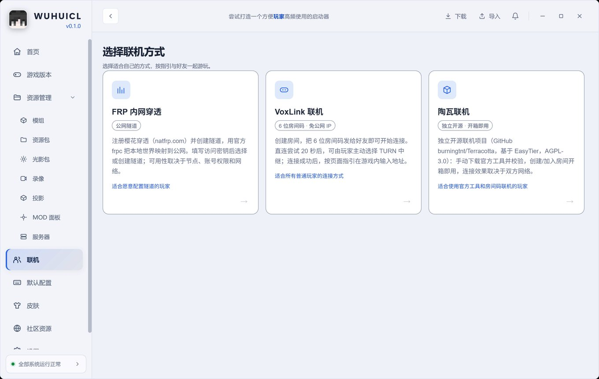

<div align="center">



# WUHUICL

[](LICENSE)
[](https://github.com/AUGUHDAR/WUHUICL/releases)

</div>

## 说明

[KAMUCL](https://github.com/kamubaba-i/KAMUCL) 的社区版，用 Rust 和 Tauri 2 重写。原版开着太占地方，压一压，看能到多少。眼下界面跟原版很像，功能还在搬，新东西排在后面，两边以后会越走越远。

装版本、管实例、下模组和资源包、管皮肤，开游戏前把内存和按键调好，这是它每天干的活。

## 注意

正版登录暂时用不了。Client ID 是自建的应用注册，Mojang 白名单没批，最后一步过不去。离线登录和外置登录正常。

联机还没接到界面上。点连接会提示"引擎未移植"，这是没做完，不是 BUG。

早期版本，原版的毛病带过来一些，还在清。遇到不对的地方开 issue 说一声。

代码里不少是 AI 写的，为了赶进度。不喜欢的换别的用。

## 下载

| 渠道 | 地址 |
| --- | --- |
| GitHub Releases | <https://github.com/AUGUHDAR/WUHUICL/releases> |
| Gitee | <https://gitee.com/AUGUHDAR/WUHUICL> |
| QQ 群 `1045554684` 群文件 | 国内快一些 |

三个渠道同一份文件。Release 里有 SHA-256：

```powershell
Get-FileHash .\WUHUICL-0.1.0.exe -Algorithm SHA256
```

## 运行

双击就行，不用装，不要管理员权限。不想用了删掉 exe。

Windows 10 缺 WebView2 运行时会打不开，启动器会提示去装。没签名，SmartScreen 拦的时候点*更多信息 → 仍要执行*。

数据跟原版分开，两个启动器可以放一台机器上用：

```
%APPDATA%\com.wuhuicl.app     设置、账号、日志
%APPDATA%\.wuhuicl            默认游戏目录
```

## 界面



首页。左边是当前实例、运行环境、内存、运行状态、最近游戏，右边是账户和皮肤预览。



模组页。按实例隔离，列表带中文名对照，开关和更新检测都在这里。



联机入口。FRP 内网穿透、VoxLink 房间码、陶瓦三条路，卡片上写了各自适合谁。

## 反馈

issue：<https://github.com/AUGUHDAR/WUHUICL/issues>，新建时有模板。日志最有用，位置在这两处：

```
游戏目录\versions\你的实例\logs\latest.log
%APPDATA%\com.wuhuicl.app\logs\
```

群里喊也行（`1045554684`），或者 B 站私信 <https://space.bilibili.com/526277131>。安全问题别开公开 issue，报法在 [SECURITY.md](.github/SECURITY.md)。

## 许可

MIT，见 [LICENSE](LICENSE)。从 KAMUCL 和 VoxLink 改写来的文件保留 `LGPL-3.0-only` 声明，明细在 [THIRD_PARTY_NOTICES.md](THIRD_PARTY_NOTICES.md)。Minecraft 的名称、贴图、音效版权归 Mojang / Microsoft。

---
---

<div align="center">


# WUHUICL

[](LICENSE)
[](https://github.com/AUGUHDAR/WUHUICL/releases)

</div>

## About

Community edition of [KAMUCL](https://github.com/kamubaba-i/KAMUCL), rewritten in Rust and Tauri 2. The original takes up too much while running, and pushing that down is the whole point. Screens still match the original for now, features are still being moved over, new work comes later. The two will pull apart.

Install versions, keep instances, download mods and packs, manage skins, set memory and keybindings before launching.

## Notes

Official login doesn't work yet. The Client ID is a separate app registration and Mojang hasn't approved it, so the last call fails. Offline and external auth are fine.

Multiplayer isn't wired to the interface. Connect says "engine not ported". Unfinished work, not a bug.

Early version. Some of the original's problems came along and are being cleared out. Open an issue when something looks wrong.

Much of the code was written with AI to keep up the pace. Not your taste, use something else.

## Download

| Channel | Address |
| --- | --- |
| GitHub Releases | <https://github.com/AUGUHDAR/WUHUICL/releases> |
| Gitee | <https://gitee.com/AUGUHDAR/WUHUICL> |
| QQ group `1045554684` files | faster in China |

Same file on all three. The release page lists a SHA-256:

```powershell
Get-FileHash .\WUHUICL-0.1.0.exe -Algorithm SHA256
```

## Running it

Double-click. Nothing installs, no admin rights. Delete the exe when it's no longer wanted.

Windows 10 needs the WebView2 Runtime, and the app will ask for it. No code signing, so when SmartScreen blocks it, choose *More info → Run anyway*.

Data is separate from the original. Both launchers can live on one machine:

```
%APPDATA%\com.wuhuicl.app     settings, accounts, logs
%APPDATA%\.wuhuicl            default game directory
```

## Screens


Home. Left side: current instance, runtime, memory, status, recent games. Right side: accounts and skin preview.


Mods, kept per instance. Chinese name aliases in the list, toggles and update check here.


Multiplayer. FRP tunnel, VoxLink room code, Terracotta. Each card says who it suits.

## Feedback

Issues: <https://github.com/AUGUHDAR/WUHUICL/issues>, templates when creating one. Logs are the most useful thing to attach:

```
<game dir>\versions\<instance>\logs\latest.log
%APPDATA%\com.wuhuicl.app\logs\
```

QQ group `1045554684` or bilibili DMs <https://space.bilibili.com/526277131> both work. Security problems: not a public issue, see [SECURITY.md](.github/SECURITY.md).

## License

MIT, see [LICENSE](LICENSE). Files adapted from KAMUCL and VoxLink keep their `LGPL-3.0-only` headers, listed in [THIRD_PARTY_NOTICES.md](THIRD_PARTY_NOTICES.md). Minecraft's name, textures and sounds belong to Mojang / Microsoft.
